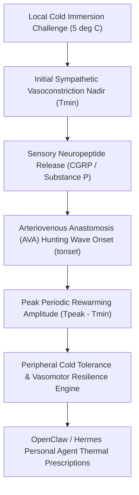

# Cutaneous Cold-Induced Vasodilation (CIVD) Skill

[](LICENSE)
[](https://www.python.org/)
[](requirements.txt)
[](mcp_server.py)
[](SKILL.md)

Zero-dependency sovereign personal agent skill for non-invasive evaluation of Cutaneous Cold-Induced Vasodilation (CIVD), Lewis hunting reaction, rewarming amplitude, and peripheral cold injury resilience.



## Features
- **Deterministic Math**: Pure Python standard library implementation with zero external dependencies.
- **Environmental Physiology Standards**: Implements validated equations for Lewis hunting reaction, rewarming amplitude, and hunting index.
- **Microvascular Cold Defense**: Early screening for digital vasospasm, Raynaud's vulnerability, and cold injury predisposition.
- **Model Context Protocol (MCP)**: Native JSON-RPC tool integration for LLMs and autonomous agents.

## Quickstart

```python
from client import CutaneousCIVDClient

client = CutaneousCIVDClient()
result = client.evaluate_civd(
    baseline_temp_c=33.2,
    minimum_temp_c=9.2,
    peak_rewarming_temp_c=15.0,
    onset_time_min=6.2
)
print("Rebound Amplitude:", result["rebound_amplitude_deg_c"], "deg C")
print("Cold Resilience Score:", result["cold_resilience_score"])
print("Classification:", result["classification"])
```

## License
Apache-2.0
